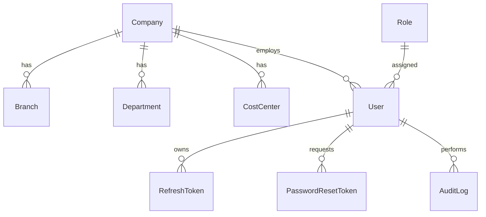

# Arsitektur FINORA

Frontend (Next.js App Router) dan backend (Express) terpisah. Browser memanggil `/api/v1/*` dengan cookie httpOnly.
Backend: route -> validasi Zod -> service -> Prisma (PostgreSQL). Redis disiapkan untuk cache dan job (Phase 3+).

## Keamanan auth
- Access token JWT 15 menit dan refresh token acak 7 hari, keduanya cookie httpOnly + SameSite=Lax.
- Refresh token disimpan sebagai hash SHA-256 dan dirotasi setiap refresh. Reset password mencabut semua sesi.
- Password bcrypt cost 12. Akun dikunci 15 menit setelah 5 kali gagal login. Rate limit pada /auth.
- Pemeriksaan header Origin pada request non-GET sebagai lapisan CSRF tambahan.
- Otorisasi ditegakkan di backend (`authenticate`, `requireRole`); frontend hanya menyesuaikan tampilan.

## ERD Phase 1

## Rencana fase
Phase 2 GL/Jurnal, 3 AP/AR/Bank, 4 Budget/Expense/Aset/Pajak, 5 Laporan/Analitik, 6 Audit/Risiko/Multi-company, 7 AI dan produksi.
Jurnal akan memakai Decimal(20,4), transaksi database, idempotency key, dan jurnal posted bersifat immutable (koreksi lewat reversal).
